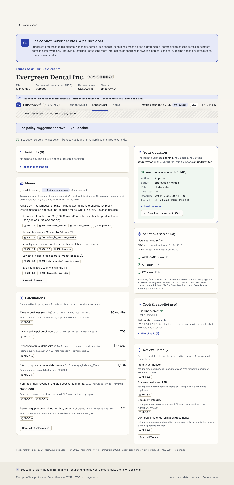
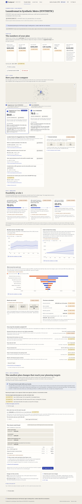
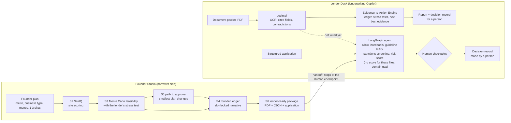

# Fundproof: a two-sided lending copilot

Fundproof is a two-sided lending copilot for small-business loans. The **Lender Desk** (the **Underwriting
Copilot**) turns a document packet into a cited, stress-tested recommendation that a person decides on, and
**Founder Studio** gives the borrower the same lens: site scoring, a Monte Carlo feasibility check under the lender's
stress test, a path-to-approval search and a lender-ready package that hands off to the Lender Desk.

**How it was built:** Rahul Vajja and Bhavani Adula wrote the specs, build prompts and evaluation protocol and
review the work; Claude Code is the implementer. Each built phase has a walkthrough so both owners can explain it
(the SIG section planned in [docs/innovations.md](docs/innovations.md) is not written yet).

> **Synthetic data notice.** A portfolio project, not a product. It uses only public datasets and **SYNTHETIC**
> (computer-generated) documents, applications, customers, founder plans and cities, each labeled as synthetic. No
> real personal data, no production users, not deployed. Fundproof is a working name. Founder Studio is an
> educational planning tool: not financial, legal or lending advice; lenders make their own decisions.

## What each side does

**Lender Desk: the Underwriting Copilot** (small-business loans and commercial insurance submissions)

- reads a packet: extracted fields with page citations, cross-document contradictions, embedded-instruction checks
- screens names against sanctions lists (OFAC SDN, OpenSanctions)
- runs the reference policy's calculations and stress tests (revenue drops, rate rises, claim increases)
- ranks the next piece of evidence worth requesting with a rules-based, scenario-based value-of-information score
  (could the answer change the recommendation?)
- drafts a cited memo (today a deterministic template; no language model has written one yet) and stops at a
  **human checkpoint**: it never approves or declines on its own, and every decision is a hash-chained record made
  by a person

**Founder Studio: the borrower side**

- **SiteIQ** scores 1-3 candidate sites from public data and shows its data coverage; missing factors stay UNKNOWN
- **Feasibility**: a Monte Carlo simulation of monthly cash and DSCR, including the lender's revenue stress
- **Path to approval**: the smallest one- or two-lever plan changes that reach the simulated loan targets (it never
  promises approval)
- **Narrative**: the plan summary can only place `{{claim:...}}` slots; code fills every number from the ledger

## Status

Each row links the results file a script wrote and the walkthrough that explains the work. Numbers in these status
tables are copied from, or counted directly in, the results file in the same row (for example 627 = 179 + 184 + 89 +
175). Unlike the generated tables under [Results](#results), they are not checked by a unit test.

**Status key.** **Built + measured**: code, offline tests in CI, and a metric written to `results/*.json` by a script.
**Built, tests only**: code and offline tests, no metric file. **Smoke only**: ran end to end on a tiny sample; quote
no rate from it. **In progress**: code is partial, unreviewed or not yet run. **Not started** / **Not deployed**.

### Lender Desk (Underwriting Copilot)

| Component | Status | What the results file says | Results | Docs |
|---|---|---|---|---|
| Risk models: credit PD (Lending Club), insurance claim frequency and severity (freMTPL2), `/score` API | Built + measured | Credit test AUC 0.7151 [0.7123, 0.7177], out-of-time 2017-2018; insurance rows under Results; not applied to the SYNTHETIC commercial files ([domain gap](docs/risk_service.md#the-domain-gap-why-the-agent-still-records-no-model-score)) | [risk_metrics.json](results/risk_metrics.json) | [Phase 1](docs/walkthrough_phase1.md), [model cards](docs/model_cards/) |
| Document intelligence (Phase 2): text layer + Tesseract OCR, cited field extraction, contradiction checks | Built + measured (rules extractor) | Field F1 0.9936 on 60 SYNTHETIC test packets; the LLM extractor is tested with a fake LLM only | [docintel_metrics.json](results/docintel_metrics.json) | [Phase 2](docs/walkthrough_phase2.md) |
| KYC / sanctions screening (OFAC SDN + OpenSanctions) | Built + measured | Recall 0.6889 of true matches at 103.8 alerts per 1,000 (rules only); adverse-media memo not measured | [kyc_metrics.json](results/kyc_metrics.json) | [Phase 3](docs/walkthrough_phase3.md) |
| Evidence-to-Action Engine (Phase 4): evidence ledger, stress tests, value-of-information evidence requests, decision record | Built + measured | Calculations agree 590/590 with oracle extraction and 488/590 end to end from the PDFs (60 SYNTHETIC packets); no LLM | [evidence_metrics.json](results/evidence_metrics.json) | [Phase 4](docs/walkthrough_phase4.md) |
| Agent + human checkpoint (Phase 5): LangGraph, allow-listed tools, guideline authority limits | Built + measured (no LLM) | 60/60 required escalations reached the right human queue; routing agreement 0.7538 (n=65); 0 decisions without a human; memo = deterministic template | [agent_metrics.json](results/agent_metrics.json) | [Phase 5](docs/walkthrough_phase5.md), [design](docs/agent_design.md) |
| MCP server (the same tool allow-list) | Built + measured (smoke test) | 17/17 checks over stdio and 17/17 over streamable HTTP | [stdio](results/mcp_smoke_stdio.json), [HTTP](results/mcp_smoke_streamable_http.json) | [mcp.md](docs/mcp.md) |
| RAG over SYNTHETIC guidelines + public regulations (Qdrant: dense, BM25, hybrid, rerank) | Retrieval built + measured; answers smoke only | Hybrid + rerank Recall@5 0.9078, MRR@10 0.8285 (103 questions); its recall gain over dense is not significant (the interval includes 0) | [rag_metrics.json](results/rag_metrics.json) | [RAG design](docs/rag_design.md), [GenAI](docs/walkthrough_genai.md) |
| Numeric provenance checker + slot grammar (SIG) | Built + measured (mutation test) | Caught every value (179/179), x10 (184/184), unit (89/89) and cross-section (175/175) mutation (627 in all) with 0/290 false flags (0/203 unmutated, 0/87 rewrites); comparator flips 88/108; wrong row 6/55 (known blind spot). Tested on guideline sentences, not memos | [provenance_metrics.json](results/provenance_metrics.json) | [plan](docs/innovations.md), [fixes](docs/walkthrough_innovations_s1.md) |
| LLM provider layer: Anthropic, OpenAI, Ollama, Hugging Face Inference (off by default), fake; cost cap, cache | Built; live calls smoke only | Anthropic and OpenAI never called (no key). Ollama runs: see [Language models](#language-models-what-has-actually-run) | [generation smoke](results/generation/smoke/generation_metrics_smoke.json) | [GenAI](docs/walkthrough_genai.md) |
| Prompt-injection containment (innovation S2) | Smoke only | Decision containment enforced by tests; tripwire flags 12/60 frozen payloads (no model); attack-success run: 3 of 240 planned calls | [detector](results/injection/injection_metrics_detector_only.json), [smoke](results/injection/smoke/injection_metrics_smoke.json) | [S2](docs/walkthrough_innovations_s2.md) |
| Security (Phase 5 B): roles, packet permissions, encryption at rest, hash-chained audit events | Built, tests only | Several controls are written and tested but not yet called by an entry point a user runs | none | [security.md](docs/security.md) |
| Observability: OpenTelemetry / OpenInference spans with PII redaction | Built, tests only | none | none | [Phase 5](docs/walkthrough_phase5.md) |
| Governance: results provenance blocks; LLM migration gate (frozen retrieval, pre-registered non-inferiority rule) and freeze proofs | Provenance built; gate in progress | The gate's code and tests exist; the full champion and challenger runs have not run, so no gate decision exists | none yet | [S1b](docs/walkthrough_innovations_s1.md) |
| Governance (Phase 6): decision lineage, monitoring (drift, calibration, indicators), reviewer feedback with reason codes, champion/challenger and outcomes, release gate (CI job), governance packs | Built + measured (SYNTHETIC / SIMULATED; no LLM) | Monitor of a separate demonstration claim-frequency GLM (no inventory model is monitored) on SIMULATED freMTPL2 streams with SYNTHETIC injected drift: false alerts in 1/300 no-drift streams, a 25% claim-rate rise detected in 298/300 and a 10% rise in 49/300; SYNTHETIC champion/challenger AUC difference -0.0003 [-0.0029, 0.0025], keep champion; SIMULATED reviewer override rate 0.1385 [0.0615, 0.2308] (describes the simulation); release gate 11 PASS, 0 FAIL, 0 MISSING, 4 NOT_MEASURED. Credit-model monitoring, real-data champion/challenger and real outcomes not measured (no Lending Club data) | [governance_metrics.json](results/governance_metrics.json), [monitoring report](results/monitoring_report.html) | [Phase 6](docs/walkthrough_phase6.md), [bank pack](docs/governance/bank_model_risk.md), [insurance outline](docs/governance/insurance_ai_program.md) |

Not wired yet: the web Lender Desk runs the Phase 5 agent on SYNTHETIC **structured** applications. The packet path
(document intelligence, then the Evidence-to-Action Engine) runs from the command line (`make run-evidence`).

### Founder Studio (borrower side)

| Component | Status | What the results file says | Results | Docs |
|---|---|---|---|---|
| S1 data fabric: the 5 largest US metros + a SYNTHETIC metro (Census ACS and CBP, LEHD LODES, Overture places, FHWA HPMS roads, BLS, FRED, HUD) | Built + measured (coverage) | All 5 real metros are in limited mode because their lowest business type, short-term rental, has data coverage 0.6779 to 0.6826 (motel 0.745 to 0.7722), below the 0.80 threshold; car wash, laundromat, restaurant/cafe and retail storefront meet it (0.8675 to 0.9415) | [studio_metro_coverage.json](results/studio_metro_coverage.json) | [S1](docs/studio/walkthrough_s1.md) |
| S2 SiteIQ: site scoring and "suggest a better area" | Built + measured (10 SYNTHETIC cities) | On Spearman rank correlation with the hidden true demand: beats the single-factor baseline for 1 of 6 business types (short-term rental, +0.0853 [0.0542, 0.1153]), is worse for retail storefront (-0.1945 [-0.2362, -0.1494]), and the interval includes 0 for the other 4 | [studio_siteiq_metrics.json](results/studio_siteiq_metrics.json) | [S2](docs/studio/walkthrough_s2.md) |
| S3 Monte Carlo feasibility: 1,000 paths over 36 months, with the lender's stress test | Built + measured (2,400 SYNTHETIC worlds per condition) | Well-specified worlds: Brier for P(year-2 DSCR >= 1.25) 0.1405 [0.1321, 0.1493] vs 0.4796 [0.4596, 0.4992] for a single-point forecast (in-sample base rate 0.1567 [0.1473, 0.1664]); misspecified worlds 0.1433 [0.1351, 0.1523] vs 0.4938 [0.4729, 0.5154] (base rate 0.1557). Simulated, based on stated assumptions | [studio_feasibility_metrics.json](results/studio_feasibility_metrics.json) | [S3](docs/studio/walkthrough_s3.md) |
| S4 founder ledger + provenance-locked narrative | Built + measured (template); LLM smoke only | Template: 1,673/1,673 narrative numbers traced to the ledger on 36 scenarios (by construction; measured before the S4 review fixes; after them the 6 SYNTHETIC-city scenarios gave 285/285 and the 30 real-city ones were not re-run). Wrong-slot blind spot: the three checks together flag 5/60 (Wilson 95% [0.0361, 0.1807]). `qwen2.5-1.5b-instruct-f16`: none of 12 drafts (6 first tries, 6 retries) passed the grammar, so all 6 fell back to the template (pre-review, approximate run; see S4 walkthrough, section 6.2) | [template](results/studio_evidence_metrics.json), [after review](results/studio_evidence_metrics_synthetic.json), [Ollama](results/studio_evidence_metrics_ollama.json) | [S4](docs/studio/walkthrough_s4.md) |
| S5 path to approval: the smallest 1-2 plan changes that reach the simulated loan targets | Built + measured | Found a path for 0.1026 [0.0784, 0.1306] of the 536 SYNTHETIC plans that needed a change; a path that also meets the SYNTHETIC startup program's equity and loan rules (NSP-3.1, NSP-8.1) for 0.0392 [0.0243, 0.0578] | [studio_path_metrics.json](results/studio_path_metrics.json) | [S5](docs/studio/walkthrough_s5.md) |
| S6 lender-ready package (PDF + JSON) and handoff to the Lender Desk | Built + measured (template memo); review fixes applied | 36 golden SYNTHETIC packages: 30,681 printed numbers read back, 0 untraced in the package text and 0 in the PDF text; 36/36 reached the agent's human checkpoint and 0 decisions were recorded without a human (Wilson 95% [0.0, 0.0964]). 35 SYNTHETIC startup applications: 35/35 agree with their hand-written labels (Wilson 95% [0.9011, 1.0]; labels written against the same SYNTHETIC program). The 30 real-metro packages ran in limited mode (no data snapshot). The web app does not call the handoff | [studio_handoff_metrics.json](results/studio_handoff_metrics.json) | [S6](docs/studio/walkthrough_s6.md), [sources](docs/studio/sources.md) |
| S8 privacy and security: plan access log, expiring share links, "Delete all my data", upload screen, CI dependency and secret scans, Privacy and Terms pages, STRIDE threat model | Built + checked; adversarial review fixes applied (no metric) | Checks, not measurements: the offline suite passes; `make scan-secrets` found no leaks in 145 commits and `make audit-deps` no known vulnerabilities (2026-10-20). There is no upload route, so the upload screen is not called yet. The new pages were not part of the Playwright or axe runs. Privacy and Terms are drafts pending the owners' approval | none (no metric) | [S8](docs/studio/walkthrough_s8.md), [threat model](docs/studio/threat_model.md), [privacy](docs/studio/privacy.md) |

### Web app and deployment

| Component | Status | What the results file says | Results | Docs |
|---|---|---|---|---|
| Web app v0.1 (FastAPI + Next.js): Founder Studio portal + Lender Desk DEMO | Built + measured (local container) | 5/5 Playwright flows (19/19 steps); 0 serious or critical axe issues in 32 scans. Signed in with the local dev login; Hugging Face OAuth is not exercised end to end | [web_metrics.json](results/web_metrics.json), [deployment_metrics.json](results/deployment_metrics.json) | [S7](docs/studio/walkthrough_s7.md), [frontend](docs/web/frontend.md), [auth](docs/web/auth.md) |
| Deployment (Hugging Face Docker Space) | Not deployed | The Space and the deploy workflow exist; no deploy has run, so there is no public URL | none | [deployment.md](docs/deployment.md) |

## Screenshots

<table>
  <tr>
    <th width="60%">Lender Desk DEMO: findings with guideline citations, calculations, sanctions screening, a template
    memo and a DEMO decision entered at the human checkpoint (by the metrics script)</th>
    <th width="40%">Founder Studio results: site comparison, simulated feasibility and the path-to-approval search</th>
  </tr>
  <tr>
    <td valign="top"><a href="docs/web/screenshots/e2e/lender-decision-1280-light.png"></a></td>
    <td valign="top"><a href="docs/web/screenshots/e2e/studio-results-1280-light.png"></a></td>
  </tr>
</table>

Captured by `scripts/web_metrics.py` on 2026-10-14 from a LOCAL container (commit `271ca4d`) signed in with the dev
login, not the Space. The script typed the plan and the decision. Everything shown is SYNTHETIC. Click an image for
full size.

## Run the demo

Needs Python 3.11 with [uv](https://docs.astral.sh/uv/), and Node 22 with npm.

```bash
cp .env.example .env     # every setting is documented there; the demo needs no API key
make setup               # Python environment from uv.lock
make web-install         # frontend dependencies (npm ci)
make web-dev             # http://localhost:3000, local DEV LOGIN (any username, pick a role)
```

- **Founder Studio**: make a plan in the SYNTHETIC metro (works offline). **Lender Desk**: open a SYNTHETIC file
  from the demo queue and record a DEMO decision.
- For guideline citations in the Lender Desk, build the index first: `make data-regulatory index`. Sanctions
  screening reads the lists that `make data` downloads.
- No Python? `make web-install web-build web-mock` serves the built pages with answers recorded from the real app
  (http://127.0.0.1:4174).
- Command-line demos: `make agent-demo` (needs `make index eval-kyc`) runs the agent to its human checkpoint, then a
  scripted decision; `make packets run-evidence` runs the Evidence-to-Action Engine on one SYNTHETIC packet.

## Language models: what has actually run

- **Hosted APIs (Anthropic, OpenAI)**: adapters built and tested with fakes, **never called** (no API key was
  configured). No agent, KYC or evidence metric above used a generative model (the agent's memo is the deterministic
  template).
- **Local open-weight models on Ollama, smoke runs only** (quote no rates from them):
  - RAG answers (innovation S1b): `qwen2.5-3b-instruct-q4km` (champion) and `qwen2.5-1.5b-instruct-f16`
    (challenger), 3 questions each, status `smoke`:
    [generation_metrics_smoke.json](results/generation/smoke/generation_metrics_smoke.json).
  - Prompt-injection evaluation (innovation S2): `qwen2.5-3b-instruct-q4km`, 3 of the 240 planned calls, status
    `smoke`: [injection_metrics_smoke.json](results/injection/smoke/injection_metrics_smoke.json).
  - Founder Studio narrative (S4): `qwen2.5-1.5b-instruct-f16` on 6 scenarios; none of its 12 drafts (6 first
    tries, 6 retries) passed the slot grammar, so all 6 fell back to the template. Measured before the S4 review
    fixes; the commit its provenance block names is not the code that ran, so the S4 walkthrough (section 6.2) says
    to treat it as approximate: [studio_evidence_metrics_ollama.json](results/studio_evidence_metrics_ollama.json).
- **Hugging Face Inference**: off by default, never run.
- Not measured yet: LLM memo quality, answer faithfulness at full size, LLM cost and LLM latency.

## Architecture



| Package | Purpose |
|---|---|
| `src/uwcopilot/risk` | Phase 1 credit and insurance models, scenario interface, `/score` API and its client |
| `src/uwcopilot/docintel` | Phase 2 SYNTHETIC packet generator, OCR, cited extraction, checks, contradiction graph, injection scan |
| `src/uwcopilot/kyc` | Phase 3 watchlist loading, name matching, reranker, adverse-media memo stub |
| `src/uwcopilot/evidence` | Phase 4 evidence ledger, calculations, stress tests, evidence requests, decision records, simulator |
| `src/uwcopilot/agent` | Phase 5 LangGraph agent, human checkpoint, reference policies, template memo, claim checker |
| `src/uwcopilot/security` | Phase 5 B roles, packet permissions, encryption at rest, audit chain, injection containment |
| `src/uwcopilot/provenance` | SIG numbers, numeric checker, slot grammar and renderer |
| `src/uwcopilot/llm`, `rag`, `tools`, `mcp_server`, `observability` | GenAI layer: providers, Qdrant retrieval, tool allow-list, MCP server, tracing |
| `src/uwcopilot/governance` | Results provenance, freeze proofs, LLM migration gate; Phase 6 lineage, monitoring, reviewer feedback, outcomes, champion/challenger, model status registry, release gate, governance packs |
| `src/uwcopilot/studio` | Founder Studio: data fabric, SiteIQ, feasibility, path to approval, narrative, package and handoff |
| `src/uwcopilot/web`, `frontend/` | Web app v0.1: FastAPI backend and Next.js static export |

The full plans are [docs/build_prompts.md](docs/build_prompts.md) (lender side) and
[docs/studio/founder_studio_build_prompts.md](docs/studio/founder_studio_build_prompts.md) (Founder Studio).

## Reproduce the results

`make help` lists every target. `make ci` is what CI runs: ruff lint and format check, then the offline tests.

```bash
cp .env.example .env      # add your Kaggle key for Lending Club; every setting is documented there
make setup                # install exact versions from uv.lock
make ci                   # ruff lint + format check, offline tests
make data                 # download the public datasets
make phase1               # Phase 1: insurance and fairness models, credit (needs the Kaggle data), reports
make serve                # scoring API on http://127.0.0.1:8000 (interactive docs at /docs)
```

The GenAI-track steps, in order (`make all` runs these after Phase 1, except the `make mcp` server; the document,
evidence, provenance, Studio and web steps below are separate targets):

```bash
make index                # Qdrant index of the guidelines + regulatory documents (fastembed models, no torch)
make eval-rag             # retrieval evaluation -> results/rag_metrics.json
make kyc-data eval-kyc    # SYNTHETIC KYC customers, sanctions screening evaluation -> results/kyc_metrics.json
make eval-agent           # LangGraph agent on 65 SYNTHETIC applications -> results/agent_metrics.json
make eval-agent-homonyms  # sensitivity run without the namesake redraw -> results/agent_metrics_homonyms_kept.json
make mcp-smoke            # MCP server smoke test over stdio and streamable HTTP -> results/mcp_smoke_*.json
make readme-results       # rewrite the GenAI results table below from results/*.json
make mcp                  # serve the tools to an MCP client over stdio
```

The document and evidence steps (Phases 2 and 4; no LLM call):

```bash
make packets              # SYNTHETIC document packets (PDF + ground truth) -> data/processed/packets/
make eval-docintel        # the document pipeline on the 60 test packets -> results/docintel_metrics.json
make simulate-requests    # innovation S5 evidence-request simulator -> results/evidence_metrics.json ("simulator")
make eval-evidence        # the engine on the 60 SYNTHETIC test packets -> results/evidence_metrics.json ("packets")
make reports              # rewrite the model cards and the first results table below
```

Numeric provenance, Founder Studio and the web app:

```bash
make eval-provenance            # SIG checker mutation test -> results/provenance_metrics.json
make injection-detector         # S2 tripwire only, no model -> results/injection/injection_metrics_detector_only.json
make eval-injection-smoke       # S2 3-call smoke on Ollama -> results/injection/smoke/
make studio-data studio-coverage  # real-metro snapshots (needs the Census key) -> results/studio_metro_coverage.json
make studio-siteiq              # SiteIQ on 10 SYNTHETIC cities -> results/studio_siteiq_metrics.json
make studio-feasibility         # feasibility simulator on SYNTHETIC worlds -> results/studio_feasibility_metrics.json
make studio-evidence            # founder ledger + template narrative, 36 golden scenarios (needs the snapshots)
                                #   -> results/studio_evidence_metrics.json
make studio-evidence-synthetic  # the same on the 6 SYNTHETIC-city scenarios -> results/studio_evidence_metrics_synthetic.json
make studio-evidence-ollama     # local 1.5B model, 6 scenarios -> results/studio_evidence_metrics_ollama.json
make studio-paths               # path-to-approval search -> results/studio_path_metrics.json
make docker-build-archive docker-smoke  # labelled image of HEAD, container smoke test -> results/deployment_metrics.json
make web-metrics-tools docker-build-archive  # pinned Lighthouse + axe, and the labelled image web-metrics requires
make web-metrics                # Playwright, axe, Lighthouse on a local container (Docker) -> results/web_metrics.json
```

## Results

No number in these tables is typed by hand. Two scripts write them from `results/*.json`, and unit tests fail if the
README and the results files disagree. Rows that have not been run say "not measured", with the reason.

Phase 1 risk models, the document pipeline (Phase 2), the Evidence-to-Action Engine (Phase 4) and the evidence-request simulator (innovation S5), written by `make reports` from `results/risk_metrics.json`, `results/docintel_metrics.json` and `results/evidence_metrics.json`:

<!-- RESULTS:START -->
| Component | Metric | Value |
|---|---|---|
| Credit-default model (Lending Club), chosen model | Test AUC, out-of-time 2017-2018 [95% CI] | 0.7151 [0.7123, 0.7177] |
| Insurance frequency (freMTPL2), Poisson GLM baseline | Mean Poisson deviance, test [95% CI] (lower is better) | 0.4584 [0.4488, 0.4672] |
| Insurance frequency (freMTPL2), LightGBM | Mean Poisson deviance, test [95% CI] | 0.4493 [0.4395, 0.4583] |
| Insurance frequency, LightGBM minus GLM | Paired difference in mean Poisson deviance [95% CI] | -0.0091 [-0.0107, -0.0075] |
| Insurance frequency, LightGBM (preferred on validation) | Lorenz Gini, test [95% CI] | 0.3208 [0.3065, 0.3365] |
| Insurance severity (freMTPL2), GLM (preferred on validation) | Mean Gamma deviance, test [95% CI] | 1.1678 [1.0855, 1.2565] |
| Insurance severity, LightGBM minus GLM | Paired difference in mean Gamma deviance [95% CI] | -0.0024 [-0.0135, 0.0089] |
| Expected loss = frequency x severity, GLM pair | Observed / predicted capped loss, test [95% CI] | 1.0187 [0.9570, 1.0812] |
| Expected loss = frequency x severity, LightGBM pair | Observed / predicted capped loss, test [95% CI] | 1.0437 [0.9808, 1.1093] |
| Expected loss, pair served by the API (LightGBM frequency x GLM severity) | Observed / predicted capped loss, test [95% CI] | 1.0185 [0.9569, 1.0822] |
| Fairness demo (UCI German Credit), logistic regression | Adverse impact ratio, age under 25 vs 25 and over [95% CI] | 0.855 [0.669, 1.051] |
| Document extraction, rules extractor on the PDF (text layer, OCR on scans), SYNTHETIC test packets | Field F1, micro-averaged over every value [95% CI] | 0.9936 [0.9889, 0.9971] |
| Contradiction detection, same run | Recall: injected problems found [95% CI] (k/n problems) | 0.9412 [0.8723, 1.0000] (48/51) |
| Contradiction detection, same run | Precision: contradictions that match an injected problem [95% CI] (k/n contradictions) | 0.7500 [0.6027, 0.8868] (51/68) |
| Evidence-to-Action Engine, oracle extraction (SYNTHETIC test packets) | Claim-status agreement with the documented status rules (same author; not held out) [95% CI] (k/n claims) | 0.9935 [0.9857, 0.9987] (2,309/2,324) |
| Evidence-to-Action Engine, pipeline extraction from the PDF (SYNTHETIC test packets) | Claim-status agreement with the documented status rules (same author; not held out) [95% CI] (k/n claims) | 0.9703 [0.9500, 0.9852] (1,926/1,985) |
| Evidence-to-Action Engine, oracle extraction (SYNTHETIC test packets) | Calculation agreement with the as-documented application [95% CI] (k/n calculations) | 1.0000 exact [0.9938, 1.0000] (590/590) |
| Evidence-to-Action Engine, pipeline extraction from the PDF (SYNTHETIC test packets) | Calculation agreement with the as-documented application [95% CI] (k/n calculations) | 0.8271 [0.7332, 0.9078] (488/590) |
| Evidence-to-Action Engine, oracle extraction (SYNTHETIC test packets) | Top-ranked request answered with its hidden truth changes the recommendation [95% CI] (k/n) | 0.4186 [0.2856, 0.5714] (18/43) |
| Evidence-to-Action Engine, pipeline extraction from the PDF (SYNTHETIC test packets) | Top-ranked request answered with its hidden truth changes the recommendation [95% CI] (k/n) | 0.3529 [0.2121, 0.5173] (12/34) |
| Evidence-to-Action Engine, oracle extraction (SYNTHETIC test packets) | Share of evaluable packets stable across every tested shock [95% CI] (k/n) | 0.6667 [0.5333, 0.7833] (40/60) |
| Evidence-to-Action Engine, pipeline extraction from the PDF (SYNTHETIC test packets) | Share of evaluable packets stable across every tested shock [95% CI] (k/n) | 0.6600 [0.5098, 0.7843] (33/50) |
| Evidence-request simulator (innovation S5), SYNTHETIC test cases, documented priors | VOI minus checklist: cost-weighted requests per case, paired [95% CI] | -1.2689 [-1.4515, -1.0932] (n=370) |
| Evidence-request simulator (innovation S5), SYNTHETIC test cases, documented priors | VOI minus checklist: decision error vs the full-information recommendation, paired [95% CI] | 0.0135 [0.0000, 0.0270] (n=370) |
| Evidence-request simulator, held-out family (claims history mismatch) | VOI minus checklist: cost-weighted requests per case, paired [95% CI] | -2.2167 [-2.8004, -1.7496] (n=30) |
| Evidence-request simulator, held-out family (claims history mismatch) | VOI minus checklist: decision error vs the full-information recommendation, paired [95% CI] | 0.1667 [0.0667, 0.3333] (n=30) |

Written by `scripts/render_reports.py` from `results/risk_metrics.json`. Bootstrap: 1,000 resamples, seed 42. Model cards and the validation report are in [docs/model_cards/](docs/model_cards/).

Document rows: written by the same script from `results/docintel_metrics.json` (`make eval-docintel`, the Phase 2 pipeline on SYNTHETIC packets; [walkthrough](docs/walkthrough_phase2.md)). Bank-statement transaction rows are most of the values, so the field F1 is mostly a transaction-table metric (per document type and page condition in the JSON). A share marked exact shows the exact Clopper-Pearson interval, because its bootstrap interval has zero width (every resample gave the same share). Simulated documents only: no real-world accuracy claim.

Evidence-to-Action Engine and simulator rows: written by the same script from `results/evidence_metrics.json` (sections `packets` from `make eval-evidence` and `simulator` from `make simulate-requests`); every case is SYNTHETIC. Claim-status agreement compares the ledger with a status table written by the same author as the ledger, so it measures agreement with the documented rules, not an independent truth; it is also NOT a held-out measurement, because the table (v2) was written after the first test-split numbers had been seen (`packets.results.protocol.development_note`). The simulator compares request policies against the reference policy's full-information recommendation on cases with a hidden truth; a negative cost difference means the VOI policy asked for less, and a positive decision-error difference means it ended on the wrong recommendation more often than the checklist. Not claimable: real-world accuracy, time or cost savings, or that the VOI score is optimal. The circular next-best-evidence agreement is in the JSON, labelled circular, and not shown here.
<!-- RESULTS:END -->

GenAI track: retrieval, sanctions screening, the agent and the MCP server, written by `make readme-results`
(`scripts/update_readme_results.py`) from `results/*.json`. A unit test fails if this table and the results files
disagree.

<!-- GENAI-RESULTS:START -->
| Component | Metric | Value |
|---|---|---|
| RAG retrieval, dense (103 answerable SYNTHETIC questions) | Recall@5 / MRR@10 [95% CI] | 0.8786 [0.8155, 0.9369] / 0.7416 [0.6737, 0.8077] |
| RAG retrieval, bm25 (103 answerable SYNTHETIC questions) | Recall@5 / MRR@10 [95% CI] | 0.8107 [0.7379, 0.8835] / 0.6349 [0.5591, 0.7065] |
| RAG retrieval, hybrid (103 answerable SYNTHETIC questions) | Recall@5 / MRR@10 [95% CI] | 0.9029 [0.8447, 0.9563] / 0.7788 [0.7170, 0.8380] |
| RAG retrieval, hybrid_rerank (103 answerable SYNTHETIC questions) | Recall@5 / MRR@10 [95% CI] | 0.9078 [0.8544, 0.9563] / 0.8285 [0.7683, 0.8846] |
| RAG retrieval, hybrid_rerank minus dense | Paired difference in recall@5 [95% CI] | 0.0291 [-0.0291, 0.0874] |
| RAG answers | Faithfulness / citation accuracy | not measured (no LLM key) |
| Sanctions screening, rules only (SYNTHETIC test customers) | Recall of true matches [95% CI] | 0.6889 [0.5476, 0.8182] |
| Sanctions screening, rules only (SYNTHETIC test customers) | Alerts per 1,000 screened [95% CI] | 103.8 [89.9, 118.9] |
| Sanctions screening, rules only (SYNTHETIC test customers) | False-positive rate on clean customers [95% CI] | 0.0887 [0.0760, 0.1030] |
| Sanctions screening, exact-name namesakes (separate stratum, n=648) | Alert rate at the same threshold [95% CI] | 0.7855 [0.7546, 0.8149] |
| Agent (65 SYNTHETIC applications, template memo) | Required escalations that reached the right human queue [95% CI] | 1.0000 [1.0000, 1.0000] (n=60) |
| Agent | End-to-end routing agreement with designed labels [95% CI] | 0.7538 [0.6462, 0.8462] (n=65) |
| Agent | Decisions recorded without a human | 0 |
| Agent injection detector | Recall on the generator's own injection phrasings [95% CI] | 0.8571 [0.5714, 1.0000] (n=7) |
| Agent | Latency p95 per application, no LLM call (ms) [95% CI] | 657.0 [580.9, 701.7] |
| Agent | Memo agreement / citation accuracy (needs an LLM) | not measured: no LLM provider was used |
| Agent | LLM cost and p95 latency per application | not measured: no LLM provider was used |
| Agent screening, final set | Routing agreement / clean parties flagged [95% CI] | 0.7538 [0.6462, 0.8462] (n=65) / 0.1917 [0.1399, 0.2487] (n=193) |
| Agent screening, namesakes kept, sensitivity run | Routing agreement / clean parties flagged [95% CI] | 0.7077 [0.6000, 0.8154] (n=65) / 0.3368 [0.2746, 0.4041] (n=193) |
| MCP server smoke test (stdio) | Checks passed | 17 / 17 |
| MCP server smoke test (streamable_http) | Checks passed | 17 / 17 |

Written by `scripts/update_readme_results.py` from `results/rag_metrics.json`, `results/kyc_metrics.json`, `results/agent_metrics*.json` and `results/mcp_smoke_*.json`. Intervals: percentile bootstrap, 1,000 resamples, seed 42. All data is SYNTHETIC or public. None of these runs called a generative LLM (retrieval used the fastembed embedding and reranker models; the agent used the deterministic template memo), so the LLM-dependent rows are not measured.
<!-- GENAI-RESULTS:END -->

## Datasets and licenses

Raw datasets are **never committed**. `make data` downloads everything into `data/raw/` and logs a SHA-256 checksum
for each file in `data/raw/checksums.jsonl`. Small offline test fixtures are committed in `tests/studio/fixtures`:
short excerpts recorded from the public APIs, hand-written SYNTHETIC stand-ins where a host could not be recorded,
and a 60-row Overture places sample (see [docs/studio/data_sources.md](docs/studio/data_sources.md)).

| Dataset | Used for | Source | License / terms |
|---|---|---|---|
| Lending Club accepted loans 2007-2018 | Credit-default model | Kaggle `wordsforthewise/lending-club` | See the Kaggle dataset page. Needs a Kaggle API key. |
| freMTPL2freq / freMTPL2sev | Insurance claim-frequency model | OpenML [41214](https://www.openml.org/d/41214) / [41215](https://www.openml.org/d/41215) (originally from the CASdatasets R package) | OpenML lists CC0 |
| UCI Statlog German Credit | Fairness demonstration | [UCI ML Repository](https://archive.ics.uci.edu/dataset/144/statlog+german+credit+data) | CC BY 4.0 |
| OFAC SDN list (+ aliases) | Sanctions screening | [US Treasury OFAC](https://www.treasury.gov/ofac/downloads/sdn.csv) | US government public data |
| OpenSanctions "default" (simplified CSV) | Sanctions screening | [OpenSanctions](https://www.opensanctions.org/datasets/default/) | CC BY-NC 4.0. Data from OpenSanctions.org, used non-commercially with attribution. |
| deepset/prompt-injections, revision `4f61ecb038e9c3fb77e21034b22511b523772cdd` | Prompt-injection evaluation (innovation S2): the 40 public attack payloads | [Hugging Face](https://huggingface.co/datasets/deepset/prompt-injections) (by deepset) | The dataset card's YAML header lists two licenses: `apache-2.0` at the top level and `cc-by-4.0` inside `dataset_info`. Both are recorded in `eval/injection_payloads_manifest.json` and neither is chosen. The one exception among the datasets above: 40 train rows are committed in `eval/injection_payloads.jsonl` (the evaluation must be frozen before any model sees it). Each was changed by appending one goal sentence; its original text is kept verbatim in `original_text`. Licenses: [CC BY 4.0](https://creativecommons.org/licenses/by/4.0/), [Apache-2.0](https://www.apache.org/licenses/LICENSE-2.0); attribution, the change made and a copy of the Apache-2.0 text are in `eval/LICENSE-deepset-prompt-injections.txt`. Not yet in the list of public datasets in CLAUDE.md rule 2, and the 40 committed rows are an exception to its "do not commit raw datasets": both need the owners' confirmation (the plan in docs/innovations.md, S2, proposes the dataset; it does not change CLAUDE.md). |
| Founder Studio public data: Census (ACS, Business Patterns, Geocoder), LEHD LODES, Overture Maps places, FHWA HPMS, BLS, FRED, HUD | Site scoring and metro inputs for the 5 real metros | Each source, its connector and its fallback: [docs/studio/data_sources.md](docs/studio/data_sources.md) | Per source in that file; several terms are still marked "to verify" there |
| Synthetic packets, applications, customers, news snippets, founder plans and cities | Every evaluation above | Generated by scripts in this repo | Synthetic, generated here |

## Limitations

- Documents, applications, customers, news snippets, founder plans and the SYNTHETIC metro are synthetic. Real
  packets and real cities are messier.
- No hosted LLM (Anthropic, OpenAI) has been called, and the local Qwen runs are smoke tests. Memo quality, answer
  faithfulness, LLM cost and LLM latency are not measured.
- The web Lender Desk runs the agent on structured SYNTHETIC applications; the packet path (document intelligence
  and the Evidence-to-Action Engine) runs from the command line only. The founder-to-lender handoff runs from the
  command line (`make studio-handoff`) on SYNTHETIC packages only; the web app does not use it.
- Founder Studio probabilities are simulation estimates ("simulated, based on stated assumptions"), validated only
  on SYNTHETIC worlds and cities written by the same author. There is no real-world accuracy claim, and the five
  real metros run in limited mode.
- Sanctions screening is name-only. Its clean false-positive rate is measured on a population without exact-name
  namesakes, so it is a lower bound; namesakes are reported as a separate stratum.
- Models are trained on public datasets that may not represent any particular lender's or insurer's portfolio. The
  Phase 1 models do not apply to the SYNTHETIC commercial packets and applications, so the evidence engine and the
  agent leave model PD unknown ([domain gap](docs/risk_service.md#the-domain-gap-why-the-agent-still-records-no-model-score)).
- Lending Club has no protected attributes, so the fairness analysis is a demonstration on a different dataset
  (UCI German Credit).
- Most results files that carry a `git_dirty` flag (18 of 22) record `git_dirty: true` (written from an uncommitted
  tree). The four clean ones are the SIG file, the post-review Studio S4 SYNTHETIC-city run, the Studio S4 Ollama
  run (whose provenance the S4 walkthrough says to treat as approximate) and the Studio S6 handoff run. The older
  agent, KYC, RAG, risk and MCP files have no dirty flag. The Phase 2 and Phase 4 walkthroughs list their clean-tree
  re-runs as still pending.
- Not deployed and no production users. The web app was measured only on a local container. Nothing here has been
  validated for real lending or insurance decisions.
- Business-value numbers, when added, are measured on the synthetic test set against a defined baseline. They
  do not show real-world savings.
- The governance documents show how a model-risk program could be structured. They are not a compliance program.
- The copilot only makes suggestions. A human makes every decision.
