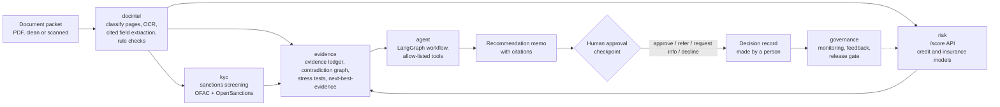

# Underwriting Copilot: evidence-driven underwriting intelligence

An AI underwriting platform for **small-business loans** and **commercial insurance submissions**.

A packet of documents goes in. Out come:

- extracted fields, each with a page citation
- cross-document contradictions (for example, stated revenue vs bank deposits), separated into benign and unsupported
- a sanctions / KYC screening result
- a calibrated risk score with plain-language reason codes
- stress tests: how the risk and the recommendation change if revenue drops, rates rise, or claims increase
- the next piece of evidence worth requesting, ranked by whether it could change the decision
- a recommendation memo and an auditable decision record that **a human must approve**

The copilot never auto-declines. Every decline, sanctions hit, and reconciliation failure goes to a human reviewer.

> **Synthetic data notice.** This is a portfolio project. It uses only public datasets and **synthetic**
> (computer-generated) documents, customers, and news snippets. It contains no real personal data and has no
> production users. Every synthetic artifact is labeled as synthetic.

## Problem

Underwriters spend much of their time reading packets (applications, bank statements, financials, loss runs),
re-keying numbers, checking that the numbers agree, screening names against sanctions lists, and writing up a
recommendation. This project automates the reading and checking, and leaves the decision to a person.

The central question: how can a lender or insurer decide faster while showing that every important conclusion
is supported by evidence, financially justified, consistent with policy, and safe to act on?

The signature component is the **Evidence-to-Action Engine** (Phase 4, built on SYNTHETIC packets). For one case
it builds an evidence ledger that tags every value the recommendation rests on as verified (with its document, page
and line), conflicting, unknown, or a model estimate; runs stress scenarios and counterfactuals through the
deterministic reference policy (the Phase 1 risk models do not apply to these commercial packets, so model PD and
expected loss stay unknown); checks whether resolving each open question would change the recommendation; and
ranks the evidence requests by a rules-based, scenario-based value-of-information score. It prepares and
explains; a person decides. See [docs/walkthrough_phase4.md](docs/walkthrough_phase4.md).

## Architecture



| Package | Phase | Purpose | Status |
|---|---|---|---|
| `src/uwcopilot/risk` | 1 | Credit-default (Lending Club) and claim frequency/severity (freMTPL2) models, scenario interface, model cards, `/score` API | Built ([walkthrough](docs/walkthrough_phase1.md), [model cards](docs/model_cards/)); `client.py` is the HTTP client of the `/score` service, shared by the agent and the MCP server |
| `src/uwcopilot/docintel` | 2 | Synthetic packet generator, text layer + Tesseract OCR, rules field extraction with citations (an LLM extractor exists, tested with a fake LLM only), deterministic checks, contradiction graph, prompt-injection detection | Built ([walkthrough](docs/walkthrough_phase2.md)); measured with the rules extractor only |
| `src/uwcopilot/kyc` | 3 | Watchlist loading, name matching, embedding reranker, adverse-media memo stub | Built ([walkthrough](docs/walkthrough_phase3.md)) |
| `src/uwcopilot/evidence` | 4 | Evidence ledger, financial calculations, stress tests, next-best-evidence ranking, decision records, evidence-request simulator (innovation S5) | Built ([walkthrough](docs/walkthrough_phase4.md)) |
| `src/uwcopilot/agent` | 5 | LangGraph agent with a human-approval checkpoint, role-based access, tracing, adversarial evaluation | Built ([design](docs/agent_design.md), [walkthrough](docs/walkthrough_phase5.md)) |
| `src/uwcopilot/governance` | 6 | Versioning, monitoring, reviewer feedback, champion/challenger, CI release gate | Not built |
| `src/uwcopilot/llm` | GenAI | Provider adapter (Anthropic, OpenAI, fake) with explicit settings, cost cap, response cache | Built ([walkthrough](docs/walkthrough_genai.md)) |
| `src/uwcopilot/rag` | GenAI | Retrieval over SYNTHETIC guidelines + public regulatory documents in Qdrant: dense, BM25, hybrid, reranked | Built ([design](docs/rag_design.md)) |
| `src/uwcopilot/tools`, `src/uwcopilot/mcp_server` | GenAI | The tool allow-list with strict schemas, exposed to any MCP client | Built ([design](docs/mcp.md)) |
| `src/uwcopilot/observability` | GenAI | OpenTelemetry / OpenInference spans with PII redaction | Built |
| `src/uwcopilot/common` | 0 | Shared helpers (paths, checksums, settings reader) | Built |

The diagram shows the planned design. Each component is built in the phase listed above; see
[docs/build_prompts.md](docs/build_prompts.md) for the full plan. The last column says what exists;
a component marked "not built" does not exist yet.

## Datasets and licenses

Raw data is **never committed**. `make data` downloads everything into `data/raw/` and logs a SHA-256 checksum
for each file in `data/raw/checksums.jsonl`.

| Dataset | Used for | Source | License / terms |
|---|---|---|---|
| Lending Club accepted loans 2007-2018 | Credit-default model | Kaggle `wordsforthewise/lending-club` | See the Kaggle dataset page. Needs a Kaggle API key. |
| freMTPL2freq / freMTPL2sev | Insurance claim-frequency model | OpenML [41214](https://www.openml.org/d/41214) / [41215](https://www.openml.org/d/41215) (originally from the CASdatasets R package) | OpenML lists CC0 |
| UCI Statlog German Credit | Fairness demonstration | [UCI ML Repository](https://archive.ics.uci.edu/dataset/144/statlog+german+credit+data) | CC BY 4.0 |
| OFAC SDN list (+ aliases) | Sanctions screening | [US Treasury OFAC](https://www.treasury.gov/ofac/downloads/sdn.csv) | US government public data |
| OpenSanctions "default" (simplified CSV) | Sanctions screening | [OpenSanctions](https://www.opensanctions.org/datasets/default/) | CC BY-NC 4.0. Data from OpenSanctions.org, used non-commercially with attribution. |
| deepset/prompt-injections, revision `4f61ecb038e9c3fb77e21034b22511b523772cdd` | Prompt-injection evaluation (innovation S2): the 40 public attack payloads | [Hugging Face](https://huggingface.co/datasets/deepset/prompt-injections) (by deepset) | The dataset card's YAML header lists two licenses: `apache-2.0` at the top level and `cc-by-4.0` inside `dataset_info`. Both are recorded in `eval/injection_payloads_manifest.json` and neither is chosen. The one exception to "never committed": 40 train rows are committed in `eval/injection_payloads.jsonl` (the evaluation must be frozen before any model sees it). Each was changed by appending one goal sentence; its original text is kept verbatim in `original_text`. Licenses: [CC BY 4.0](https://creativecommons.org/licenses/by/4.0/), [Apache-2.0](https://www.apache.org/licenses/LICENSE-2.0); attribution, the change made and a copy of the Apache-2.0 text are in `eval/LICENSE-deepset-prompt-injections.txt`. Not yet in the list of public datasets in CLAUDE.md rule 2, and the 40 committed rows are an exception to its "do not commit raw datasets": both need the owners' confirmation (the plan in docs/innovations.md, S2, proposes the dataset; it does not change CLAUDE.md). |
| Synthetic packets, customers, news snippets | Document intelligence, KYC, agent evaluation | Generated by scripts in this repo | Synthetic, generated here |

## How to run

Requires Python 3.11 and [uv](https://docs.astral.sh/uv/).

```bash
cp .env.example .env      # add your Kaggle key (and an LLM key from Phase 2 on); every setting is documented there
make setup                # install exact versions from uv.lock
make ci                   # what CI runs: ruff lint + format check, offline tests
make data                 # download the public datasets
make phase1               # Phase 1: insurance and fairness models, credit (needs the Kaggle data), reports
make serve                # scoring API on http://127.0.0.1:8000 (interactive docs at /docs)
```

The GenAI-track steps, in order (`make all` runs everything):

```bash
make index                # Qdrant index of the guidelines + regulatory documents (fastembed models, no torch)
make eval-rag             # retrieval evaluation -> results/rag_metrics.json
make kyc-data eval-kyc    # SYNTHETIC KYC customers, sanctions screening evaluation -> results/kyc_metrics.json
make eval-agent           # LangGraph agent on 65 SYNTHETIC applications -> results/agent_metrics.json
make eval-agent-homonyms  # sensitivity run without the namesake redraw -> results/agent_metrics_homonyms_kept.json
make mcp-smoke            # MCP server smoke test over stdio and streamable HTTP -> results/mcp_smoke_*.json
make readme-results       # rewrite the results table below from results/*.json
make agent-demo           # one fake-LLM run to the human checkpoint, then a scripted demo decision
make mcp                  # serve the tools to an MCP client over stdio
```

The document and evidence steps (Phases 2 and 4; no LLM call):

```bash
make packets              # SYNTHETIC document packets (PDF + ground truth) -> data/processed/packets/
make run-evidence         # the Evidence-to-Action Engine on one packet (PACKET=PKT-C-024): report + decision record
make simulate-requests    # innovation S5 evidence-request simulator -> results/evidence_metrics.json ("simulator")
make eval-evidence        # the engine on the 60 SYNTHETIC test packets -> results/evidence_metrics.json ("packets")
make reports              # rewrite the model cards and the first results table below
```

There is no LLM API key in this environment, so no LLM call has been made; every metric that needs a model says
"not measured". Run `make help` to see every target.

## Results

No number in these tables is typed by hand. Rows that have not been run say "not measured", with the reason.

Phase 1 risk models, the document pipeline (Phase 2), the Evidence-to-Action Engine (Phase 4) and the evidence-request simulator (innovation S5), written by `make reports` from `results/risk_metrics.json`, `results/docintel_metrics.json` and `results/evidence_metrics.json`:

<!-- RESULTS:START -->
| Component | Metric | Value |
|---|---|---|
| Credit-default model (Lending Club), chosen model | Test AUC, out-of-time 2017-2018 [95% CI] | 0.7151 [0.7123, 0.7177] |
| Insurance frequency (freMTPL2), Poisson GLM baseline | Mean Poisson deviance, test [95% CI] (lower is better) | 0.4584 [0.4488, 0.4672] |
| Insurance frequency (freMTPL2), LightGBM | Mean Poisson deviance, test [95% CI] | 0.4493 [0.4395, 0.4583] |
| Insurance frequency, LightGBM minus GLM | Paired difference in mean Poisson deviance [95% CI] | -0.0091 [-0.0107, -0.0075] |
| Insurance frequency, LightGBM (preferred on validation) | Lorenz Gini, test [95% CI] | 0.3208 [0.3065, 0.3365] |
| Insurance severity (freMTPL2), GLM (preferred on validation) | Mean Gamma deviance, test [95% CI] | 1.1678 [1.0855, 1.2565] |
| Insurance severity, LightGBM minus GLM | Paired difference in mean Gamma deviance [95% CI] | -0.0024 [-0.0135, 0.0089] |
| Expected loss = frequency x severity, GLM pair | Observed / predicted capped loss, test [95% CI] | 1.0187 [0.9570, 1.0812] |
| Expected loss = frequency x severity, LightGBM pair | Observed / predicted capped loss, test [95% CI] | 1.0437 [0.9808, 1.1093] |
| Expected loss, pair served by the API (LightGBM frequency x GLM severity) | Observed / predicted capped loss, test [95% CI] | 1.0185 [0.9569, 1.0822] |
| Fairness demo (UCI German Credit), logistic regression | Adverse impact ratio, age under 25 vs 25 and over [95% CI] | 0.855 [0.669, 1.051] |
| Document extraction, rules extractor on the PDF (text layer, OCR on scans), SYNTHETIC test packets | Field F1, micro-averaged over every value [95% CI] | 0.9936 [0.9889, 0.9971] |
| Contradiction detection, same run | Recall: injected problems found [95% CI] (k/n problems) | 0.9412 [0.8723, 1.0000] (48/51) |
| Contradiction detection, same run | Precision: contradictions that match an injected problem [95% CI] (k/n contradictions) | 0.7500 [0.6027, 0.8868] (51/68) |
| Evidence-to-Action Engine, oracle extraction (SYNTHETIC test packets) | Claim-status agreement with the documented status rules (same author; not held out) [95% CI] (k/n claims) | 0.9935 [0.9857, 0.9987] (2,309/2,324) |
| Evidence-to-Action Engine, pipeline extraction from the PDF (SYNTHETIC test packets) | Claim-status agreement with the documented status rules (same author; not held out) [95% CI] (k/n claims) | 0.9703 [0.9500, 0.9852] (1,926/1,985) |
| Evidence-to-Action Engine, oracle extraction (SYNTHETIC test packets) | Calculation agreement with the as-documented application [95% CI] (k/n calculations) | 1.0000 exact [0.9938, 1.0000] (590/590) |
| Evidence-to-Action Engine, pipeline extraction from the PDF (SYNTHETIC test packets) | Calculation agreement with the as-documented application [95% CI] (k/n calculations) | 0.8271 [0.7332, 0.9078] (488/590) |
| Evidence-to-Action Engine, oracle extraction (SYNTHETIC test packets) | Top-ranked request answered with its hidden truth changes the recommendation [95% CI] (k/n) | 0.4186 [0.2856, 0.5714] (18/43) |
| Evidence-to-Action Engine, pipeline extraction from the PDF (SYNTHETIC test packets) | Top-ranked request answered with its hidden truth changes the recommendation [95% CI] (k/n) | 0.3529 [0.2121, 0.5173] (12/34) |
| Evidence-to-Action Engine, oracle extraction (SYNTHETIC test packets) | Share of evaluable packets stable across every tested shock [95% CI] (k/n) | 0.6667 [0.5333, 0.7833] (40/60) |
| Evidence-to-Action Engine, pipeline extraction from the PDF (SYNTHETIC test packets) | Share of evaluable packets stable across every tested shock [95% CI] (k/n) | 0.6600 [0.5098, 0.7843] (33/50) |
| Evidence-request simulator (innovation S5), SYNTHETIC test cases, documented priors | VOI minus checklist: cost-weighted requests per case, paired [95% CI] | -1.2689 [-1.4515, -1.0932] (n=370) |
| Evidence-request simulator (innovation S5), SYNTHETIC test cases, documented priors | VOI minus checklist: decision error vs the full-information recommendation, paired [95% CI] | 0.0135 [0.0000, 0.0270] (n=370) |
| Evidence-request simulator, held-out family (claims history mismatch) | VOI minus checklist: cost-weighted requests per case, paired [95% CI] | -2.2167 [-2.8004, -1.7496] (n=30) |
| Evidence-request simulator, held-out family (claims history mismatch) | VOI minus checklist: decision error vs the full-information recommendation, paired [95% CI] | 0.1667 [0.0667, 0.3333] (n=30) |

Written by `scripts/render_reports.py` from `results/risk_metrics.json`. Bootstrap: 1,000 resamples, seed 42. Model cards and the validation report are in [docs/model_cards/](docs/model_cards/).

Document rows: written by the same script from `results/docintel_metrics.json` (`make eval-docintel`, the Phase 2 pipeline on SYNTHETIC packets; [walkthrough](docs/walkthrough_phase2.md)). Bank-statement transaction rows are most of the values, so the field F1 is mostly a transaction-table metric (per document type and page condition in the JSON). A share marked exact shows the exact Clopper-Pearson interval, because its bootstrap interval has zero width (every resample gave the same share). Simulated documents only: no real-world accuracy claim.

Evidence-to-Action Engine and simulator rows: written by the same script from `results/evidence_metrics.json` (sections `packets` from `make eval-evidence` and `simulator` from `make simulate-requests`); every case is SYNTHETIC. Claim-status agreement compares the ledger with a status table written by the same author as the ledger, so it measures agreement with the documented rules, not an independent truth; it is also NOT a held-out measurement, because the table (v2) was written after the first test-split numbers had been seen (`packets.results.protocol.development_note`). The simulator compares request policies against the reference policy's full-information recommendation on cases with a hidden truth; a negative cost difference means the VOI policy asked for less, and a positive decision-error difference means it ended on the wrong recommendation more often than the checklist. Not claimable: real-world accuracy, time or cost savings, or that the VOI score is optimal. The circular next-best-evidence agreement is in the JSON, labelled circular, and not shown here.
<!-- RESULTS:END -->

GenAI track: retrieval, sanctions screening, the agent and the MCP server, written by `make readme-results`
(`scripts/update_readme_results.py`) from `results/*.json`. A unit test fails if this table and the results files
disagree.

<!-- GENAI-RESULTS:START -->
| Component | Metric | Value |
|---|---|---|
| RAG retrieval, dense (103 answerable SYNTHETIC questions) | Recall@5 / MRR@10 [95% CI] | 0.8786 [0.8155, 0.9369] / 0.7416 [0.6737, 0.8077] |
| RAG retrieval, bm25 (103 answerable SYNTHETIC questions) | Recall@5 / MRR@10 [95% CI] | 0.8107 [0.7379, 0.8835] / 0.6349 [0.5591, 0.7065] |
| RAG retrieval, hybrid (103 answerable SYNTHETIC questions) | Recall@5 / MRR@10 [95% CI] | 0.9029 [0.8447, 0.9563] / 0.7788 [0.7170, 0.8380] |
| RAG retrieval, hybrid_rerank (103 answerable SYNTHETIC questions) | Recall@5 / MRR@10 [95% CI] | 0.9078 [0.8544, 0.9563] / 0.8285 [0.7683, 0.8846] |
| RAG retrieval, hybrid_rerank minus dense | Paired difference in recall@5 [95% CI] | 0.0291 [-0.0291, 0.0874] |
| RAG answers | Faithfulness / citation accuracy | not measured (no LLM key) |
| Sanctions screening, rules only (SYNTHETIC test customers) | Recall of true matches [95% CI] | 0.6889 [0.5476, 0.8182] |
| Sanctions screening, rules only (SYNTHETIC test customers) | Alerts per 1,000 screened [95% CI] | 103.8 [89.9, 118.9] |
| Sanctions screening, rules only (SYNTHETIC test customers) | False-positive rate on clean customers [95% CI] | 0.0887 [0.0760, 0.1030] |
| Sanctions screening, exact-name namesakes (separate stratum, n=648) | Alert rate at the same threshold [95% CI] | 0.7855 [0.7546, 0.8149] |
| Agent (65 SYNTHETIC applications, template memo) | Required escalations that reached the right human queue [95% CI] | 1.0000 [1.0000, 1.0000] (n=60) |
| Agent | End-to-end routing agreement with designed labels [95% CI] | 0.7538 [0.6462, 0.8462] (n=65) |
| Agent | Decisions recorded without a human | 0 |
| Agent injection detector | Recall on the generator's own injection phrasings [95% CI] | 0.8571 [0.5714, 1.0000] (n=7) |
| Agent | Latency p95 per application, no LLM call (ms) [95% CI] | 657.0 [580.9, 701.7] |
| Agent | Memo agreement / citation accuracy (needs an LLM) | not measured: no LLM provider was used |
| Agent | LLM cost and p95 latency per application | not measured: no LLM provider was used |
| Agent screening, final set | Routing agreement / clean parties flagged [95% CI] | 0.7538 [0.6462, 0.8462] (n=65) / 0.1917 [0.1399, 0.2487] (n=193) |
| Agent screening, namesakes kept, sensitivity run | Routing agreement / clean parties flagged [95% CI] | 0.7077 [0.6000, 0.8154] (n=65) / 0.3368 [0.2746, 0.4041] (n=193) |
| MCP server smoke test (stdio) | Checks passed | 17 / 17 |
| MCP server smoke test (streamable_http) | Checks passed | 17 / 17 |

Written by `scripts/update_readme_results.py` from `results/rag_metrics.json`, `results/kyc_metrics.json`, `results/agent_metrics*.json` and `results/mcp_smoke_*.json`. Intervals: percentile bootstrap, 1,000 resamples, seed 42. All data is SYNTHETIC or public; no LLM call was made, so LLM-dependent metrics are not measured.
<!-- GENAI-RESULTS:END -->

## Limitations

- Documents, customers, applications and news snippets are synthetic. Real packets are messier.
- No LLM call has been made (no API key here): memo quality, answer faithfulness, LLM cost and LLM latency are
  not measured.
- Sanctions screening is name-only. Its clean false-positive rate is measured on a population without exact-name
  namesakes, so it is a lower bound; namesakes are reported as a separate stratum.
- Models are trained on public datasets that may not represent any particular lender's or insurer's portfolio.
- Lending Club has no protected attributes, so the fairness analysis is a demonstration on a different dataset
  (UCI German Credit).
- No production users. Nothing here has been validated for real lending or insurance decisions.
- Business-value numbers, when added, are measured on the synthetic test set against a defined baseline. They
  do not show real-world savings.
- The governance documents show how a model-risk program could be structured. They are not a compliance program.
- The copilot only makes suggestions. A human makes every decision.
